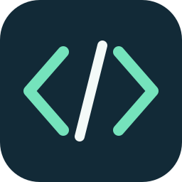

<p align="center">
  
</p>

# Power Platform Skills for Codex

**Build Power Apps, cloud flows, and Dataverse solutions with Microsoft's Power Platform skills in Codex.**

[](https://github.com/LeonardSEO/power-platform-skills-codex/actions/workflows/validate.yml)
[](https://github.com/LeonardSEO/power-platform-skills-codex/actions/workflows/sync-upstream.yml)
[](LICENSE)

An independent distribution of [Microsoft Power Platform Skills](https://github.com/microsoft/power-platform-skills)
and [Dataverse Skills](https://github.com/microsoft/Dataverse-skills), packaged for Codex with local MCP runtimes,
portable manifests, and Microsoft telemetry hard-disabled.

Use one marketplace to install the capabilities you need. Existing `code-apps-preview`
and `mobile-app` installation names remain stable. Microsoft remains the author
and copyright holder of the upstream content; this project is not affiliated
with or endorsed by Microsoft.

## Start with Power Automate

You need Codex with plugin support and **Node.js 22 LTS**. Azure CLI and a Microsoft
account with access to your target environment are needed when you connect to Power Platform.

Register the marketplace and install the Power Automate plugin:

```bash
codex plugin marketplace add LeonardSEO/power-platform-skills-codex && codex plugin add power-automate@power-platform-skills-codex
```

Restart your desktop app or start a new CLI session. Try this read-only request:

```text
Use power-automate:browse-flows to show my available environments.
Ask me which environment to use, then list its flows without changing anything.
```

Follow the plugin's setup instructions if Azure CLI authentication is required.
Access depends on your account and environment permissions. Installation does not
sign you in or grant access to an environment.

Confirm the installation:

```bash
codex plugin list --marketplace power-platform-skills-codex --json
```

## Choose your plugins

| Plugin | Skills | Purpose |
| --- | ---: | --- |
| `power-pages` | 39 | Build and deploy Power Pages code sites |
| `model-apps` | 4 | Build generative pages for model-driven apps |
| `mcp-apps` | 3 | Generate interactive MCP App widgets |
| `canvas-apps` | 4 | Author Canvas Apps through the Canvas Authoring MCP server |
| `code-apps-preview` | 15 | Build React and Vite Power Apps code apps |
| `mobile-app` | 31 | Build Expo and React Native Power Apps |
| `power-automate` | 12 | Build, edit, publish, run, and debug cloud flows |
| `pcf` | 3 | Build, test, deploy, and verify PCF components (preview) |
| `power-apps-mobile-extension` | 13 | Build native controls for wrapped Canvas apps |
| `process-intelligence` | 10 | Analyze Power Automate Process Mining data |
| `dataverse` | 10 | Query and manage Dataverse data, schema, security, and solutions |

**Total: 11 plugins and 144 skill definitions.**

The skill count includes five internal mobile implementation helpers. Those helpers
are invoked through `mobile-app:add-native`, rather than exposed as separate portable skills.

Install any additional plugin using its name from the table:

```bash
codex plugin add dataverse@power-platform-skills-codex
codex plugin add canvas-apps@power-platform-skills-codex
codex plugin add pcf@power-platform-skills-codex
```

<details>
<summary>Install every plugin</summary>

```bash
for plugin in power-pages model-apps mcp-apps canvas-apps code-apps-preview mobile-app power-automate pcf power-apps-mobile-extension process-intelligence dataverse; do
  codex plugin add "$plugin@power-platform-skills-codex" || break
done
```

</details>

### Update an existing installation

```bash
codex plugin marketplace upgrade power-platform-skills-codex
codex plugin list --marketplace power-platform-skills-codex --json
```

Restart your desktop app or start a new CLI session after updating. Check the
reported versions; install newly added plugins explicitly with `codex plugin add`.

### Desktop and Claude Code

In a desktop client that exposes local marketplaces in its Plugins directory,
select **Power Platform Skills for Codex** and install the plugins you need.
Restart the client after registering the marketplace if it is not visible yet.

For Claude Code, add the same repository from inside Claude Code, then select
plugins from the marketplace and reload them:

```text
/plugin marketplace add LeonardSEO/power-platform-skills-codex
/plugin
/reload-plugins
```

Codex's native marketplace commands are the documented installation path.
No third-party installer or remote shell script is required.

## What you can build

| Goal | Start here |
| --- | --- |
| Design a cloud flow that a customer can understand | `power-automate:build-flow` |
| Build a React and Vite Power Apps code app | `code-apps-preview:create-code-app` |
| Create or edit a Canvas App | `canvas-apps:canvas-app` |
| Query or manage a Dataverse environment | `dataverse:dv-connect` |
| Build a Power Pages site | `power-pages:create-site` |
| Build and verify a PCF component | `pcf:pcf` |
| Analyze Process Mining data | `process-intelligence:analytics` |

These are entry points, not preconfigured customer environments. Review the
selected skill's plan and required permissions before authorizing writes or deployment.

## Requirements and scope

- **Runtime:** Node.js 22 LTS covers the bundled Node-based plugins. Process Intelligence
  supports Node.js 22 or 24 LTS; Power Automate requires Node.js 20 or newer.
- **Authentication:** Azure CLI (`az`) where required by the selected plugin.
- **Power Platform tooling:** PAC CLI, .NET SDK, and other platform tools vary by plugin.
  Canvas Authoring requires .NET 10 SDK. PCF deployment also requires PAC and .NET.
- **Host:** local Codex/desktop execution for bundled processes. Installing this repository
  does not make a local process available in a browser-only or cloud host.

Read the selected plugin's README, `AGENTS.md`, and setup skill for its exact prerequisites.
Some capabilities are previews or have cloud/OS limitations. PCF is preview;
Process Intelligence does not support GCC, GCC High, DoD, or Mooncake.

## What this distribution maintains

Every plugin has a portable `plugin.json` with OpenAI presentation metadata,
plus a matching `.codex-plugin/plugin.json` compatibility manifest. Plugins with
bundled MCP servers also ship portable `mcp.json`, a Codex-native server map, and
the original upstream host configuration. The sync reapplies these files after
upstream updates; versions and icon paths are validated together.

Power Automate keeps the Node.js 22/24 FlowAgent compatibility bootstrap. Its
`build-flow` and `create-flow` skills also preserve:

- [Dutch flow design rules](config/power-automate-flow-design.md): name visible steps
  in Dutch and represent meaningful business decisions as explainable actions.
- [Custom connector discovery](config/power-automate-overrides/references/custom-connectors.md)
  before choosing actions or raw HTTP integrations.
- A user's stated Microsoft Foundry/Azure OpenAI pay-as-you-go preference.
- A `build-custom-connector` skill and [example sketches](config/power-automate-overrides/examples/custom-connectors/README.md).
  The sketches contain no customer endpoint or deployable connector credentials.

## Telemetry and credentials

Microsoft Power Platform telemetry is hard-disabled in the bundled distribution:
production instrumentation keys and collector routes are removed, Power Pages
telemetry hooks are removed, and FlowAgent telemetry is forced off. Validation
rejects enabled telemetry configurations or restored routing values.

This applies to the bundled plugins. Codex, Azure CLI, Microsoft services, and
other external tools have their own data handling and telemetry settings.
The repository contains no environment-specific authentication configuration;
set up credentials through the selected tool's supported sign-in flow.

## Upstream updates

The [weekly sync](.github/workflows/sync-upstream.yml) follows both Microsoft
repositories, records their commits independently, reapplies the Codex adaptations,
and runs `npm test`. The existing automation then opens or updates a synchronization
PR and squash-merges it after its local validation succeeds. An unsuccessful sync
stops before that step.

The repository-wide state identifies the last full Power Platform sync. Dataverse
has a separate state file; Power Automate can also be updated independently.
See [UPSTREAM.md](UPSTREAM.md) for exact mappings, commands, and preservation rules.

## Development and contributions

Clone the repository and run the existing checks; no root package installation is required:

```bash
git clone https://github.com/LeonardSEO/power-platform-skills-codex.git
cd power-platform-skills-codex
npm test
```

The checks cover portable and compatibility manifest consistency, MCP transports,
icons, skill metadata, sync regression fixtures, telemetry safeguards, and the
Codex and Claude FlowAgent initialization/tool-list handshake. They do not connect
to a customer environment or prove live deployment behavior.

For a change, create a branch, follow [AGENTS.md](AGENTS.md), add a focused regression
check for changed behavior, and open a PR against `main`. Change synchronization
rules or overlays when a fix must survive future imports. Upstream-owned feature
changes belong in the corresponding Microsoft repository.

Use [GitHub Issues](https://github.com/LeonardSEO/power-platform-skills-codex/issues)
for reproducible problems or focused requests. Include your Codex version, plugin
name/version, OS, command or prompt, expected behavior, and sanitized error output.
Never post access tokens, credentials, customer data, or private environment URLs.
For sensitive vulnerabilities, follow [SECURITY.md](SECURITY.md).

## License and attribution

[MIT](LICENSE). Microsoft copyright and upstream notices are retained. The
Dataverse license is also included in [plugins/dataverse/LICENSE](plugins/dataverse/LICENSE).
See [NOTICE.md](NOTICE.md) for the upstream sources and Codex-specific adaptations.
